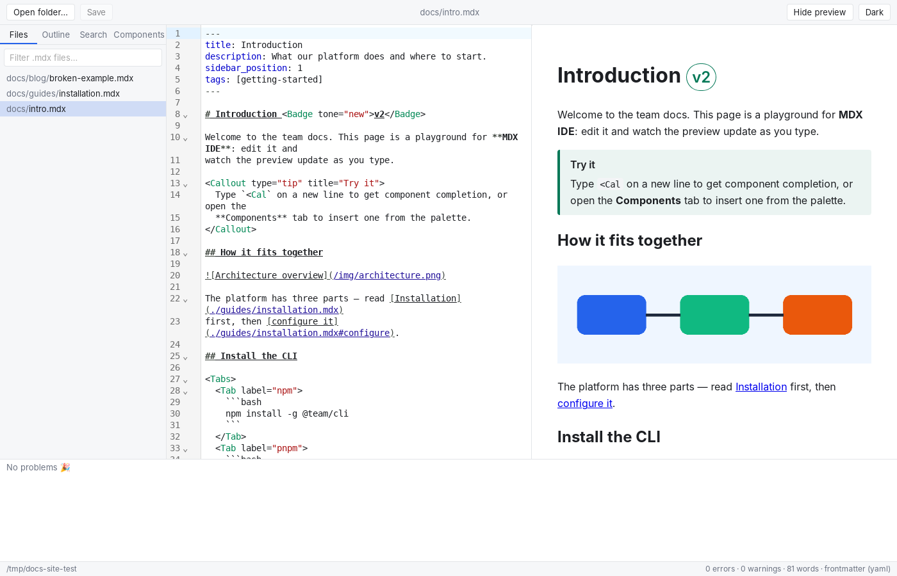

# MDX IDE

A desktop editor built only for **MDX**. It knows your team's components, frontmatter rules and docs-site conventions.

Built with **Tauri 2**. The Rust core does the parsing, compiling, checking and file work. A React + CodeMirror 6 frontend does the editing and the live preview.



## What works today (Phase 0 spike + early MVP)

| Feature | Where |
|---|---|
| Open a docs repo (folder picker or `mdx-ide path/to/repo`), `.mdx`-only explorer respecting `.gitignore`, filter / quick-open | `mdx-workspace`, `ui/src/panels` |
| CodeMirror 6 editor with YAML frontmatter, Markdown/GFM and highlighted code fences | `ui/src/editor` |
| **Live preview** compiled in Rust (`mdxjs`), rendered with React in a **sandboxed iframe on its own origin**; render errors are reported back | `mdx-compile`, `preview-runtime`, `src-tauri/src/preview_protocol.rs` |
| Editor → preview scroll sync (`data-line` injected by a Rust hast transform) | `mdx-compile::annotate_source_lines` |
| **Component intelligence** from `component-manifest.json`: tag/prop/value completion, palette, unknown component (with "did you mean"), unknown prop, missing required prop and invalid value diagnostics | `mdx-intel::manifest`, `mdx-intel::completion` |
| **Frontmatter validation** against per-collection JSON Schemas (errors point at the offending key) | `mdx-intel::frontmatter` |
| **Link checking**: relative/root-relative pages, `#anchors` (GitHub slugs), images in `static/`/`public/` | `mdx-intel::links` |
| MDX syntax errors with positions (e.g. HTML comments, unclosed JSX), image alt-text check | `mdx-syntax` |
| Outline panel, workspace search, Problems panel, word count, atomic saves, file watching (external edits reload, config hot-reloads) | various |
| **Git**: Source Control panel (status, stage, discard, commit, fetch, pull, push), branch create / switch, side-by-side source and rendered diffs, blame gutter. Needs `git` installed | `mdx-git`, `ui/src/git` |
| **Full-screen preview** (⌘⇧↵, Esc exits) and **Export to PDF** (macOS): the page as it currently looks, including component state | `ui/src/App.tsx`, `src-tauri/src/export.rs` |
| **Slide decks** (see below): present a page one slide at a time, with interactive components | `mdx-compile/src/slides.rs`, `preview-runtime/src/deck.tsx` |
| Manifest generator for React/TypeScript design systems | `sidecars/manifest-gen` |

## Slide decks

A page with `type: slides` in its frontmatter is a deck, and each `---` starts a new slide. Leave a blank line before `---`: directly under text, it makes that text a heading (the editor warns you). **New slide deck…** in the command palette (⌘K) creates a starter deck; see also `examples/docs-site/docs/guides/slides-demo.mdx`.

| Tag | Purpose |
|---|---|
| `<Slide layout="center" />` | Centres the slide it is written on. `layout="full"` removes the margins, for a large demo |
| `<Columns>` | Places each child side by side; wrap several blocks in `<Column>` |
| `<Step>` | Appears on a key press while presenting |
| `<Notes>` | Speaker notes: shown below the slide while editing, hidden while presenting and in the PDF |

A team component with one of these names replaces the built-in one (except `<Slide>`).

Press ⌘⇧↵ (Ctrl+Shift+Enter) to present from the current slide.

| Key | Action |
|---|---|
| →, Space, Page Down | Next step or slide |
| ←, Shift+Space, Page Up | Back |
| Home, End | First, last slide |
| G | All slides |
| R | Reset the components and steps on this slide |
| Esc | Close the overview, leave a field, or stop presenting |

Keys go to a component while you type in a field or use a slider, tab list or similar widget. All slides stay loaded, so components keep their state (and timers or videos keep running) until the page is edited. The preview sandbox applies: no network requests, embedded sites, browser storage or pop-up dialogs.

Slides are 960×540, scaled to fit. The Problems panel lists slides whose content does not fit. **Export to PDF** writes one 16:9 page per slide, as the components currently look, with every step shown. In decks, the lint rules for a single top-level heading and unique headings are not applied.

## Quick start

Prerequisites: Rust (stable), Node 22+, pnpm 10, and on Linux the Tauri system packages:

```bash
sudo apt install libwebkit2gtk-4.1-dev librsvg2-dev libayatana-appindicator3-dev patchelf build-essential curl wget file libssl-dev
```

```bash
pnpm install
pnpm dev                              # then "Open folder…" → examples/docs-site

cargo test --workspace                # Rust tests, incl. an end-to-end check of examples/docs-site
pnpm build                            # installers in target/release/bundle/

# Built app: open a repo straight from the terminal
./target/release/mdx-ide /absolute/path/to/docs-repo
```

Try it in `examples/docs-site`:

- `docs/intro.mdx`: type `<Cal` for completion, or open **Components** to insert from the palette.
- `docs/blog/broken-example.mdx` shows every kind of diagnostic.

> **Linux / WebKitGTK:** if the window is blank or crashes on NVIDIA/Wayland, run with `WEBKIT_DISABLE_DMABUF_RENDERER=1`. See *Risks* in [docs/ARCHITECTURE.md](docs/ARCHITECTURE.md).

## Using it in your docs repo

1. Copy `examples/docs-site/.mdx-ide/` into your docs repo and edit `config.toml` (content dirs, static dirs, schemas).
2. Generate the component manifest from your design system:

   ```bash
   # Use absolute paths: the script runs inside sidecars/manifest-gen.
   pnpm manifest --src "/path/to/design-system/src/**/*.tsx" --package @team/ui \
     --out /path/to/docs/.mdx-ide/component-manifest.json
   ```

   JSDoc tags: `@category`, `@mdxSnippet`, `@mdxIgnore`. Run it in the design system's CI.
3. *(Optional, for real components in the preview)* Build your design system as one ESM file with `react`, `react/jsx-runtime` and `react-dom` kept **external**. Then set `preview.components_bundle` (and `preview.css`). The preview rewrites those imports to its own React, so hooks work. Without a bundle, the built-in demo components in `preview-runtime/src/components.tsx` are used. `examples/custom-components/` is a minimal working example: open that folder and `docs/check.mdx`.

   ```ts
   // vite.config.ts in the design system
   build: { lib: { entry: "src/index.ts", formats: ["es"], fileName: () => "mdx-ide.js" },
            rollupOptions: { external: ["react", "react/jsx-runtime", "react-dom"] } }
   ```

4. Commit `.mdx-ide/`. Everyone gets the same checks.

## Repository layout

```
crates/
  mdx-core/        shared types (Range, Diagnostic, Outline, ...) sent over IPC
  mdx-syntax/      markdown-rs parse → outline, links, JSX usages, frontmatter, syntax errors
  mdx-compile/     mdxjs pipeline + Rust hast transforms (scroll-sync line ids)
  mdx-intel/       component manifest checks & completion, frontmatter schemas, link checker
  mdx-git/         status, staging, commits, branches, diffs and blame (git CLI)
  mdx-workspace/   team config, file discovery, search, atomic saves, full per-doc analysis
src-tauri/         Tauri shell: IPC commands, file watcher, mdxpreview:// protocol, capabilities
ui/                React + Vite + CodeMirror 6 app
preview-runtime/   React runtime inside the sandboxed preview iframe (shipped as a resource)
sidecars/          Node helpers (manifest-gen); later: mdxlint, site-accurate compile, MDX LSP
examples/          example docs repo with .mdx-ide/ team config
third_party/       one-line patched swc_common (see below)
docs/              ARCHITECTURE.md, ROADMAP.md
```

## Known gotchas

- **`third_party/swc_common`**: `mdxjs 1.0.4` pins `swc_core 27`, which pulls in `swc_common 12.0.1`. That version doesn't compile with serde ≥ 1.0.220 (`serde::__private` was renamed). The vendored copy changes one unused re-export and is wired in via `[patch.crates-io]`. Remove it when mdxjs moves to a newer SWC. **Don't add your own direct SWC dependency**; use Oxc for separate JS analysis.
- TypeScript 7 is used for the apps. The manifest generator stays on TypeScript 5.9 because `react-docgen-typescript` needs the JS compiler API.
- The preview only resolves imports of `react`, `react/jsx-runtime`, `react-dom` and your team package. Relative component imports (`./Chart.tsx`) are on the roadmap.
- IPC types in `ui/src/api.ts` are hand-written; switch to `tauri-specta` when the API settles.
